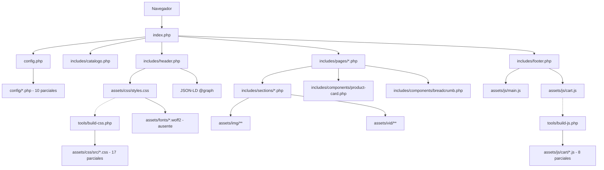
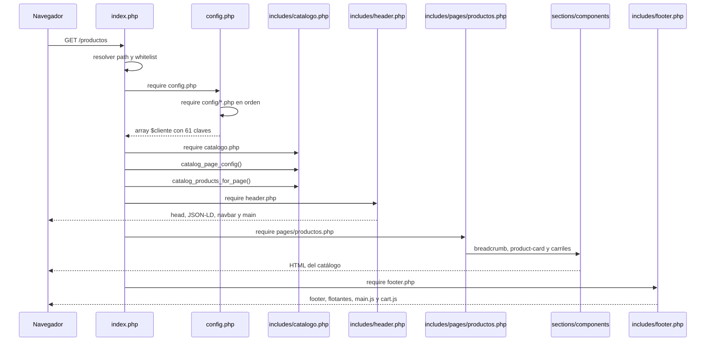
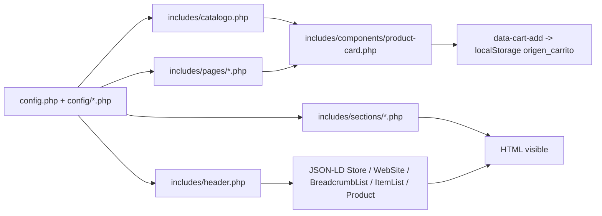

# Arquitectura — Origen8.8

Sitio PHP plano con router propio y composición por parciales: `config.php` ensambla los datos desde `config/`, `index.php` resuelve la ruta y los `includes/` renderizan; el CSS y el carrito se generan desde parciales con scripts de build. La fuente de verdad es `config.php` + `config/*.php`; los bundles no se editan a mano.

## Mapa rápido

| Ruta | Responsabilidad |
|---|---|
| `index.php` | Router, guardas del servidor embebido, whitelist de páginas, cache busting y composición `header/page/footer` (`index.php:18-88`) |
| `config.php` | Dirección/horarios base, cálculo de horarios legibles y composición de 8 parciales directos + 2 de catálogo anidados (`config.php:14-91`) |
| `config/` | Parciales de datos que retornan arrays; se cargan en orden fijo y se fusionan con `array_replace_recursive()` (`config.php:74-91`) |
| `includes/header.php` | `<head>`, metadatos, Open Graph, Twitter, canonical, JSON-LD `@graph`, navbar y apertura de `<main>` (`includes/header.php:176-278`) |
| `includes/footer.php` | Footer MiLocalWeb, badge, back-to-top, flotantes de pedido/WhatsApp y carga de scripts (`includes/footer.php:25-119`) |
| `includes/catalogo.php` | Helpers de rutas, filtros, precios, descuentos, URLs de assets y schema `Product` (`includes/catalogo.php:16-248`) |
| `includes/components/` | `breadcrumb.php` y `product-card.php`, reutilizables por las páginas |
| `includes/pages/` | `home.php`, `productos.php`, `ofertas.php`, `accesorios.php`, `carrito.php`, `not-found.php` |
| `includes/sections/` | Secciones editoriales de la home: hero, CTA, productos, nosotros, aside, local, indumentaria, clientes, estrella y ubicación |
| `assets/css/src/` | 17 parciales CSS, fuente del bundle |
| `assets/css/styles.css` | Bundle CSS minificado generado por `tools/build-css.php` (64.394 bytes) |
| `assets/js/main.js` | Interacciones de la landing y del catálogo: navbar, smooth scroll, videos, lightbox, buscador y carruseles |
| `assets/js/cart/` | 8 parciales del carrito, fuente del bundle |
| `assets/js/cart.js` | Bundle del carrito generado por `tools/build-js.php` |
| `tools/build-css.php` | Concatena y minifica los parciales CSS en `assets/css/styles.css` |
| `tools/build-js.php` | Concatena los parciales del carrito en `assets/js/cart.js` |
| `tools/test-cart-js.js` | Test Node del comportamiento del carrito |
| `tools/smoke-routes.ps1` | Smoke test HTTP de rutas y contratos mínimos |
| `tools/organize-assets.php` | Utilidad de organización de assets; no participa del request |
| `docs/` | Documentación del proyecto |

## Parciales de configuración

`config.php` define primero `$storeAddress`, `$storeOpeningHours`, `$googleBusinessProfile` y `$displayHours` (`config.php:14-68`). Después carga los parciales en este orden (`config.php:75-83`):

| Parcial | Responsabilidad |
|---|---|
| `config/datos-basicos.php` | Nombre, dominio, slogan, rubro, contacto, branding, hero, colores y tipografía |
| `config/productos-paginas.php` | Productos destacados, `paginas` y ensamblado del catálogo desde `catalogo-parte-1.php` + `catalogo-parte-2.php` |
| `config/secciones-campanas.php` | Secciones editoriales de la home: ofertas de temporada, indispensables y campaña de verano |
| `config/ubicacion.php` | Dirección, `gmaps_embed`, horarios, “Nuestro Local” y “Cómo llegar” |
| `config/indumentaria.php` | Sección de indumentaria/accesorios y video de lentes |
| `config/redes-nosotros.php` | Redes sociales y texto/video de “Quiénes Somos” |
| `config/aside-clientes.php` | Aside publicitario y vidriera de otros clientes |
| `config/seo.php` | Keywords, localidad, provincia, zona, lat/long, OG image, categorías y marcas |

`config/ubicacion.php` y `config/seo.php` consumen las variables `$storeAddress`, `$storeOpeningHours`, `$googleBusinessProfile` y `$displayHours` definidas en `config.php`; por eso la composición debe mantener ese orden. `config/productos-paginas.php` carga los dos parciales de catálogo de forma anidada (`config/productos-paginas.php:70-73`).

## Diagrama de dependencias

## Flujo de un request

La ruta se resuelve en `index.php:37-50`: `/` e `/index.php` aceptan `?p=`, el resto se toma del path; solo `home`, `productos`, `ofertas`, `accesorios` y `carrito` están en la whitelist. Cualquier otra ruta responde 404 y carga `not-found.php`. Las rutas limpias de Apache se reescriben a `index.php?p=...` en `.htaccess:43-44`; el router embebido usa el path directo.

## Flujo de datos

El contrato del carrito es client-side: `product-card.php` emite `data-cart-add`, `data-product-id`, `data-product-name`, `data-product-price`, `data-product-show-price`, `data-product-description` y `data-product-image` (`includes/components/product-card.php:89-97`). `cart.js` lee esos atributos, persiste en `localStorage` con la clave `origen_carrito` (`assets/js/cart/00-header.js:14`) y arma el mensaje de WhatsApp; el email solo se muestra si `config/datos-basicos.php:22` tiene un valor.

## CSS y JS

### CSS

- Fuente: 17 parciales en `assets/css/src/`, en el orden contractual de `tools/build-css.php:23-41`.
- Build: `php tools/build-css.php`. Concatena, elimina comentarios y colapsa whitespace; escribe `assets/css/styles.css` (64.394 bytes).
- Parcial más grande: `assets/css/src/11-campanas.css` (365 líneas).
- Cache busting: `index.php:73-81` calcula `?v=filemtime()` y lo expone como `CSS_VERSION`; `includes/header.php:225` lo usa.
- El bundle es una sola línea minificada: para revisar o cambiar estilos, editar los parciales y reconstruir. No editar `assets/css/styles.css`.

### JavaScript

- `assets/js/main.js` (347 líneas en el corte de `_audit/CHANGES-SUMMARY.md`) se documentó en sitio y no se dividió. Cubre navbar, smooth scroll, back-to-top, videos, lightbox, buscador y carriles (`assets/js/main.js:1-80`).
- `assets/js/cart.js` se genera desde 8 parciales en `assets/js/cart/`, en el orden de `tools/build-js.php:23-32`. Parcial más grande: `assets/js/cart/03-add.js` (165 líneas).
- Build: `php tools/build-js.php`. No minifica; conserva el código para diagnóstico.
- Verificación: `node --check assets/js/main.js`, `node --check assets/js/cart.js` y `node tools/test-cart-js.js`.
- Los scripts se cargan al final del body, sin `defer` (`includes/footer.php:116-117`); es deuda P2-02.

## Invariantes

- `config.php` es la composición; `config/*.php` son datos puros que retornan arrays. No agregar salida, `?>` ni whitespace antes/después del `return`.
- El orden de los parciales de `config/` no se cambia sin comparar el array resuelto: `array_replace_recursive()` sobrescribe claves en silencio.
- `$storeAddress`, `$storeOpeningHours`, `$googleBusinessProfile` y `$displayHours` deben existir antes de cargar `config/ubicacion.php` y `config/seo.php`.
- `assets/css/styles.css` y `assets/js/cart.js` son bundles generados. La fuente de verdad son `assets/css/src/` y `assets/js/cart/`.
- El orden de `tools/build-css.php:23-41` y `tools/build-js.php:23-32` es contractual; no reordenar sin revisar la cascada/IIFE.
- No usar `@import` en los parciales CSS.
- `index.php` solo sirve páginas de la whitelist; una ruta nueva requiere agregarla en `index.php:44` y crear su página.
- Los atributos `data-cart-*` son contrato con `cart.js`; no renombrarlos.
- Los datos del cliente se escapan con `htmlspecialchars()`; las únicas salidas raw son `gmaps_embed` y la tipografía configurable.
- `includes/sections/ubicacion.php` existe pero no se incluye en la home; el mapa/dirección visible está en `includes/sections/nuestro-local.php:39-62`.

## Cómo trabajar con IA

1. Leer `AGENTS.md` de la raíz.
2. Leer `docs/estado-actual.md` y este archivo.
3. Leer `config.php` y el parcial de `config/` que corresponda antes de tocar datos o secciones.
4. Si se toca CSS, editar `assets/css/src/` y correr `php tools/build-css.php`.
5. Si se toca el carrito, editar `assets/js/cart/` y correr `php tools/build-js.php`.
6. Verificar con `php -l`, `node --check`, `node tools/test-cart-js.js` y una captura HTTP de las rutas.
7. No corregir P1/P2 “de paso”: la deuda está priorizada en `docs/estado-actual.md`.

## Riesgos estructurales

- **`config/` no está bloqueado.** `.htaccess:32` solo bloquea `config.php`, `includes/` y `tools/`; `index.php:22` usa el mismo patrón. `/config/datos-basicos.php` responde 200 vacío. Agregar `config/` a ambos y a `robots.txt`.
- **Build tolerante a faltantes.** `tools/build-css.php:44-49` y `tools/build-js.php:35-39` advierten y continúan si falta un parcial; el build termina con éxito y genera un bundle incompleto. Conviene que fallen con `exit(1)`.
- **Sección de ubicación muerta.** `includes/sections/ubicacion.php` no se incluye; el mapa/dirección se duplica conceptualmente en `nuestro-local.php`. Definir una sola fuente visual antes de agregar el ancla `#ubicacion`.
- **Fuentes ausentes.** `assets/css/src/01-base.css:10-48` referencia 4 woff2 que no existen; el navegador cae a fallbacks y genera 4 404.
- **Assets públicos.** `assets/css/src/` y `assets/js/cart/` se sirven por HTTP (200). No son secretos, pero conviene bloquearlas si se quiere ocultar la fuente.
- **CSS minificado en una línea.** `assets/css/styles.css` no es revisable a mano; la revisión debe hacerse en `assets/css/src/`.
- **Documentación interna expuesta.** `/AGENTS.md`, `/README.md`, `/docs/*` y `/.gitignore` responden 200; ver P2-12.
- **README desactualizado.** `README.md:23` habla de Google Fonts, `README.md:50` lista `reels.php` y `README.md:84` atribuye `index, follow` a `robots.txt`; no usarlo como fuente de estado.

## Documentos de referencia

- [Ficha del cliente](ficha-cliente.md) — datos de negocio y relevamiento; **incompleta**.
- [Informe de estilo](informe_estilo_origen.md) — identidad visual y criterios de marca.
- [Plan de desarrollo original](plan-desarrollo-origen.md) — histórico de la landing.
- [Plan de catálogo y carrito](plan-desarrollo-origen-catalogo-carrito.md) — plan del catálogo actual.
- [Plan template reusable](plan-template-php-catalogo-carrito.md) — patrón para otros clientes.
- [Guía SEO pendiente](guia-seo-pendientes.md) y [SEO — tareas pendientes](seo-tareas-pendientes.md) — trabajo SEO detallado.
- [Estado actual](estado-actual.md), [Mapa del sitio](mapa-sitio.md) y [Resumen de documentación](resumen-documentacion.md).
