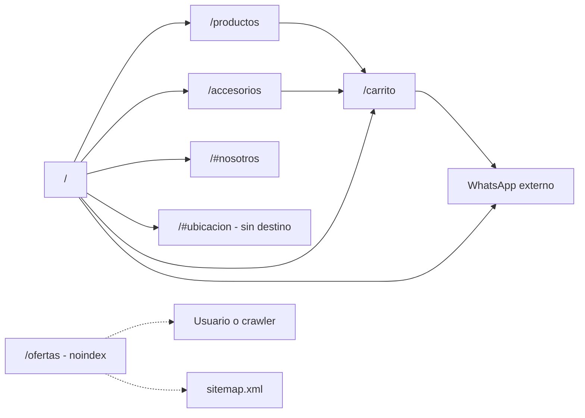

# Mapa del sitio — Origen8.8

Sitio multi-página con una home institucional, tres rutas de catálogo, un carrito de pedido asistido y un 404 personalizado. Las rutas limpias se resuelven por `.htaccess` o por el fallback `index.php?p=`; el router valida una whitelist y responde 404 para todo lo demás.

## URLs y rutas

| URL | Archivo/route | Propósito | Indexable | Canonical | Estado |
|---|---|---|---|---|---|
| `/` | `index.php` → `includes/pages/home.php` | Home institucional + catálogo destacado | Sí | `https://origen.milocalweb.com.ar/` | 200 |
| `/productos` | `index.php` → `includes/pages/productos.php` | Catálogo completo agrupado por familias | Sí | `https://origen.milocalweb.com.ar/productos` | 200 |
| `/ofertas` | `index.php` → `includes/pages/ofertas.php` | Ofertas de productos | No (`noindex` mientras esté vacía) | `https://origen.milocalweb.com.ar/ofertas` | 200 |
| `/accesorios` | `index.php` → `includes/pages/accesorios.php` | Accesorios | Sí | `https://origen.milocalweb.com.ar/accesorios` | 200 |
| `/carrito` | `index.php` → `includes/pages/carrito.php` | Pedido asistido client-side | No (`noindex, follow`) | `https://origen.milocalweb.com.ar/carrito` | 200 |
| `/no-existe` | `index.php` → `includes/pages/not-found.php` | 404 personalizado | No (`noindex, follow`) | Sin canonical | 404 |
| `/index.php` | `index.php` → home | Variante de entrada | Sí | `https://origen.milocalweb.com.ar/` | 200 |
| `/index.php?p=productos` | `index.php` → productos | Fallback de router | Sí | `https://origen.milocalweb.com.ar/productos` | 200 |
| `/productos/` | `index.php` → productos | Variante con barra final; no redirige | Sí | `https://origen.milocalweb.com.ar/productos` | 200 |
| `/ofertas?p=productos` | `index.php` → ofertas | El path gana sobre `?p=` | Sí | `https://origen.milocalweb.com.ar/ofertas` | 200 |
| `/config.php` | Bloqueado por router/.htaccess | Interno | No | — | 403 |
| `/includes/header.php` | Bloqueado por router/.htaccess | Interno | No | — | 403 |
| `/tools/smoke-routes.ps1` | Bloqueado por router/.htaccess | Interno | No | — | 403 |
| `/config/datos-basicos.php` | Servido por PHP | Parcial de configuración | No | — | 200 vacío |
| `/assets/css/styles.css` | Estático | Bundle de estilos | No aplica | — | 200 |
| `/assets/css/src/01-base.css` | Estático | Fuente CSS | No aplica | — | 200 |
| `/assets/js/main.js` | Estático | Interacciones | No aplica | — | 200 |
| `/assets/js/cart.js` | Estático | Carrito | No aplica | — | 200 |
| `/assets/js/cart/01-storage.js` | Estático | Fuente del carrito | No aplica | — | 200 |
| `/assets/fonts/open-sans-v40-latin-regular.woff2` | No existe | Fuente | No aplica | — | 404 |
| `/assets/img/cliente/logos/og-origen-88-1200x630.jpg` | Estático | OG image 1200×630 | No aplica | — | 200 |
| `/assets/img/cliente/iconos/favicon.ico` | Estático | Favicon | No aplica | — | 200 |
| `/robots.txt` | Estático | Directivas de crawl | No aplica | — | 200 |
| `/sitemap.xml` | Estático | Sitemap | No aplica | — | 200 |
| `/AGENTS.md` | Estático | Guía interna | No | — | 200 |
| `/README.md` | Estático | README interno | No | — | 200 |
| `/docs/ficha-cliente.md` | Estático | Documentación interna | No | — | 200 |
| `/.gitignore` | Estático | Configuración de git | No | — | 200 |

> Los 200 de `/AGENTS.md`, `/README.md`, `/docs/*` y `/.gitignore` son un riesgo de exposición (P2-12). El 200 vacío de `/config/datos-basicos.php` es un riesgo de hardening (P2-19): el archivo se ejecuta, pero no debería ser accesible.

## Diagrama de navegación

El navbar enlaza `/`, `/productos`, `/accesorios`, `/#nosotros`, `/#ubicacion`, `/carrito` y WhatsApp (`includes/header.php:267-275`). `/ofertas` no está en el navbar: solo se llega por URL directa. `/#ubicacion` apunta al bloque de local/mapa (`nuestro-local.php`) desde 2026-11-10; `#nuestro-local` se conserva como alias.

## Sitemap XML

Existe `sitemap.xml` ([abrir](../sitemap.xml)), XML válido con 4 URLs:

| URL | `lastmod` | `changefreq` | `priority` |
|---|---|---|---|
| `https://origen.milocalweb.com.ar/` | 2026-10-19 | `monthly` | 1.0 |
| `https://origen.milocalweb.com.ar/productos` | 2026-10-19 | `weekly` | 0.9 |
| `https://origen.milocalweb.com.ar/ofertas` | 2026-10-19 | `weekly` | 0.9 |
| `https://origen.milocalweb.com.ar/accesorios` | 2026-10-19 | `weekly` | 0.8 |

- No incluye `/carrito` (correcto: es `noindex`).
- No incluye `/ofertas` mientras esté vacía; la página responde `noindex`.
- No tiene `image:image` ni `geo:geo`; `lastmod` es fijo, no dinámico (P2-10).
- `robots.txt:7` declara el sitemap.

## Anclas internas

### Home

| Ancla | Sección | Enlace desde |
|---|---|---|
| `#inicio` | Hero | Ancla de la propia sección (`includes/sections/hero.php:25`); el navbar “Inicio” apunta a `/` |
| `#productos` | Productos destacados | Ancla de la sección (`includes/sections/productos.php:20`) |
| `#nosotros` | Quiénes Somos | Navbar “Quiénes Somos” → `/#nosotros` (`includes/header.php:271`) |
| `#nuestro-local` | Nuestro Local + mapa/dirección | Ancla de la sección (`includes/sections/nuestro-local.php:22`) |
| `#indumentaria` | Indumentaria y accesorios | Ancla de la sección (`includes/sections/indumentaria.php:16`) |
| `#ofertas` | Ofertas de temporada de la home | Ancla de la sección (`includes/sections/estrella.php:21`) |
| `#conoce-productos` | CTA al ShowRoom | Ancla de la sección (`includes/sections/cta-productos.php:11`) |
| `#ubicacion` | **No existe en la home** | Navbar “Ubicación” → `/#ubicacion` (`includes/header.php:272`); `includes/sections/ubicacion.php:14` tiene el `id`, pero no se incluye |

### Catálogo

| Ancla | Sección | Enlace desde |
|---|---|---|
| `#catalog-section-{n}` | Sección/familia del catálogo | Índice de categorías y enlaces internos de `/productos` (`includes/pages/productos.php:148`) |
| `#catalog-group-{n}-{m}` | Grupo dentro de una familia | Índice de categorías (`includes/pages/productos.php:177`) |
| `#producto-{id}-{n}-{m}` | Card de producto | Índice de productos (`includes/pages/productos.php:226`; `includes/components/product-card.php:32`) |

`/ofertas`, `/accesorios` y `/carrito` no definen anclas de navegación propias. El carrito usa atributos `data-cart-*` como contrato con `cart.js` (`includes/pages/carrito.php:37-41`).

## Enlaces internos y observaciones

- **Roto:** `/#ubicacion` no tiene destino (P1-01). El mapa/dirección existe en `#nuestro-local`; la solución más limpia es anclar `#ubicacion` allí o cambiar el navbar a `/#nuestro-local`, sin duplicar el bloque.
- **Fuera del navbar y del sitemap:** `/ofertas` no está en el navbar; mientras esté vacía responde `noindex` y no se incluye en el sitemap.
- **Ancla homónima:** `#ofertas` de la home es una sección editorial de temporada (`includes/sections/estrella.php:21`) y no debe confundirse con la página `/ofertas` del catálogo.
- **Breadcrumb en 404:** `includes/pages/not-found.php:18` renderiza migas aunque la página sea `noindex`; es una señal contradictoria menor (P2-16).
- **Canonical en carrito:** `/carrito` es `noindex, follow` pero emite canonical (`includes/header.php:26-28,215-217`); conviene omitirlo (P2-16).
- **Barra final:** `/productos/` responde 200 y canonicaliza a `/productos`; no hay redirect 301. Es aceptable, pero deja dos URLs vivas.
- **Fallback `?p=`:** `/ofertas?p=productos` renderiza ofertas porque el path gana sobre la query (`index.php:37-41`). Es el comportamiento esperado por el smoke test.
- **Internos expuestos:** `/AGENTS.md`, `/README.md`, `/docs/*` y `/.gitignore` responden 200; `robots.txt` no los desautoriza (P2-12, P2-11).
- **Fuentes locales:** los 5 woff2 de `@font-face` existen en `assets/fonts/` y responden 200 (2026-11-10).
- **Archivos fuente de assets públicos:** `assets/css/src/` y `assets/js/cart/` responden 200; no son secretos, pero se pueden bloquear si se quiere ocultar la implementación.
